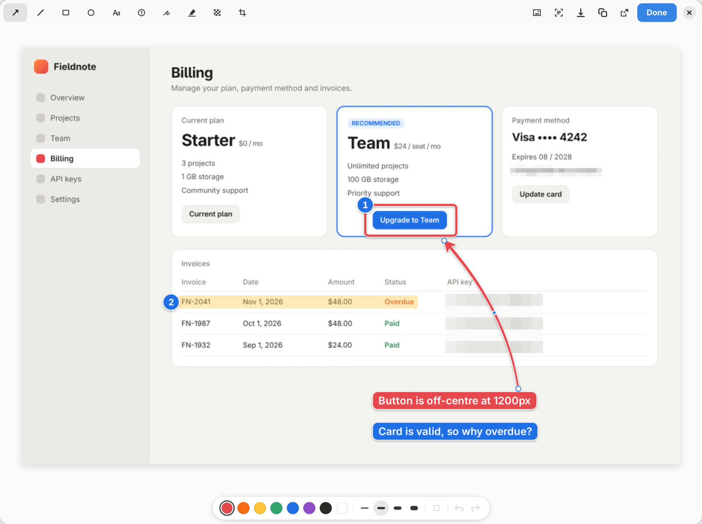

# Shotput for Linux

Screenshots for pasting, on GNOME. Press Print Screen, drag an area, and it is on the clipboard
when you let go. Annotate first when the picture needs a pointer.

**Website:** [shotput.abstergo.fyi](https://shotput.abstergo.fyi)

> **Shotput was created by [keshav-exe](https://github.com/keshav-exe) for macOS:
> [github.com/keshav-exe/shotput](https://github.com/keshav-exe/shotput).** The idea, the design,
> the editor's tools and the way every interaction feels are theirs. This repository is a port of
> it to Linux, rebuilt for GNOME Shell and GTK 4, under the same MIT licence. If you are on a Mac,
> use the original.



## Install

```bash
curl -fsSL https://shotput.abstergo.fyi/install.sh | bash
```

Then log out and back in once (GNOME loads a new extension at login) and press **Print Screen**.

No root needed. It installs `~/.local/bin/shotput`, the app entry and the GNOME Shell extension,
and sets up Tesseract for "Copy text" when it can. Needs GNOME 46 to 50: Ubuntu 24.04 LTS and
newer, Fedora 40+, Debian 13, Arch and others, on x86_64 or arm64.

Prefer to look first? Download `shotput-linux-x86_64.tar.gz` (or `-aarch64`) from
[Releases](https://github.com/Absterrg0/shotput-linux/releases/latest), unpack it and run
`./install.sh`. To build from source, clone this repository and run `./install.sh`; it builds with
cargo (needs Rust and the GTK 4 and libadwaita development files).

To remove it: `~/.local/share/shotput/uninstall.sh`. GNOME gets its Print Screen keys back.

## Shortcuts

| Action | Default | What happens |
|---|---|---|
| Capture area | Print | Drag an area. It is on the clipboard when you let go. |
| Capture area and annotate | Ctrl+Print | Same, then the editor opens where you captured. |
| Capture window | Alt+Print | Click a window. You get it alone, with clean corners. |
| Capture screen | Shift+Print | The display under the pointer. |
| Annotate last capture | Ctrl+Alt+Print | Opens the most recent capture in the editor. |
| Copy text from area | Ctrl+Shift+Print | Drag over text and it is copied as text, read on this machine. |
| Repeat last area | none | Captures the same area again, with no selection. |
| Annotate clipboard image | none | Opens the image on the clipboard in the editor. |

While Shotput is on, it borrows exactly the Print Screen shortcuts it uses from GNOME's own
screenshot tool, and gives them back when it is turned off or removed. GNOME's screen recorder
stays on Ctrl+Shift+Alt+R and in Shotput's menu. No Print Screen key? Record any other shortcut
in Settings → Shortcuts, which also warns when a key is already taken by GNOME.

Pressing a capture shortcut again while selecting backs out. Mouse software (Solaar, Piper, Input
Remapper) can press these shortcuts from a mouse button. Launchers can use `shotput area`,
`shotput annotate`, `shotput window`, `shotput text`, `shotput last`, `shotput clipboard`,
`shotput settings`, or the same as `shotput://area` links. A silent full-screen capture is
shortcut only, so another program cannot use Shotput to read your screen.

## Selecting

- The screen freezes while you select, so open menus and hover states stay put.
- The crosshair snaps to window edges, the screen edges and the top bar. The guides turn blue when
  snapped. Hold Ctrl to place freely.
- Space switches between area and window. While dragging, hold Space to move the selection and
  Shift to keep it square.
- Esc or a right click cancels. Works across monitors and with fractional scaling.

## After a capture

The image is on the clipboard straight away. A small preview then appears in the screen corner
nearest your pointer that does not cover what you captured.

- Click it to annotate. Hover for Copy again, Save, Drag into an app, and Pin.
- **Drag into an app** turns the preview into a card you can drag into a browser, chat, file
  manager or editor, as a file named like your saves. (On Wayland only an app window can start a
  drag, so the card is a tiny window of the Shotput app at the same spot.)
- Drag the preview up towards the top bar and a shelf drops out; let go over it to pin.
- Ignore it and it leaves after a few seconds. It never takes focus.

## Pins

The top bar icon holds the last 15 pins in a strip that scrolls sideways. Click a pin to copy it,
Alt-click or middle-click to annotate it. The same menu has every capture, Record Screen and
Settings.

## Annotating

| Tool | Key | Notes |
|---|---|---|
| Arrow | A | Shift snaps to 45° steps. Drag the middle handle to curve it. |
| Line | L | Drag the middle handle to curve it, double click it to straighten. |
| Rectangle | R | Shift for a square. Fill tints the inside. |
| Ellipse | O | Shift for a circle. |
| Text | T | Return finishes, Shift+Return adds a line. Double click to edit. |
| Step number | N | Counts up on each click. |
| Pen | P | Sketch a line, arrow, rectangle, or circle and it becomes one. Ctrl+Z keeps the sketch. |
| Highlighter | H | |
| Redact | B | Mosaic by default. Fill makes it a solid block. |
| Crop | C | |

Keys 1 to 8 pick a colour. Every mark has a thin halo and soft shadow. Drag a mark to move it,
drag its handles to reshape it, arrow keys nudge (Shift for 10). Delete removes it. Ctrl+scroll
or a pinch zooms; Ctrl+0 is actual size, Ctrl+9 fits.

**Return** copies the result and closes the editor. Ctrl+C copies and keeps it open, Ctrl+S
saves, and the drag handle in the toolbar drags the finished image into any app. The Background
button puts the screenshot on your wallpaper or a colour, with padding, a soft shadow and rounded
corners, and "Copy text" copies the text in the screenshot.

## How it works on Linux

- **A GNOME Shell extension** (`extension/`). On GNOME Wayland only the compositor can freeze the
  screen, snap a selection to window edges, float a preview that never takes focus, own the
  clipboard and keep a top bar icon, so captures happen there. The still is taken on the GPU
  (`Shell.Screenshot.screenshot_stage_to_content`), so the screen freezes the instant you press
  the key.
- **The editor and `shotput` command** (`editor/`, Rust, GTK 4 and libadwaita). The screenshot is
  a GPU texture and marks are render nodes with soft shadows drawn by GSK. Export renders the same
  nodes on the GPU at full resolution, so what you see is what you copy. The editor stays resident
  (about 40 MB) and is opened over D-Bus, so it appears instantly.
- Text recognition runs Tesseract on this machine. Nothing you capture leaves your computer.
- Without the extension (other desktops, or before the first re-login), `shotput area` and
  `shotput annotate` capture through the desktop's screenshot portal and open the same editor.

## Differences from the Mac version

- Captures live in a GNOME Shell extension, since Wayland gives apps no way to freeze the screen.
  It works on GNOME 46 to 50; `tests/containers/` runs GNOME 46 (Ubuntu 24.04) headless for testing.
- GNOME's top bar keeps right clicks, so pins and the capture menu share one menu.
- Dragging into apps goes through the small drag card described above.
- Text recognition uses Tesseract instead of Apple's Vision; saving offers PNG and JPEG.

## Development

```bash
cd editor && cargo test --release              # model and shape recognition tests
./target/release/shotput dev-editor /tmp/out   # renders the editor with every kind of mark
tests/nested-shell.sh                          # headless nested GNOME Shell with the extension
tests/sh-eval.sh 'sp().run("area")'            # drive it (after loading tests/drive.js)
scripts/package.sh                             # builds dist/shotput-linux-ARCH.tar.gz
```

Pushing a `v*` tag builds releases for x86_64 and arm64 on Ubuntu 24.04 (see
`.github/workflows/release.yml`). The website lives in `site/`.

## Credits and licence

Shotput is by [keshav-exe](https://github.com/keshav-exe/shotput). The Linux port is by
[Absterrg0](https://github.com/Absterrg0). Both are MIT licensed; see `LICENSE`, which keeps the
original copyright notice.
